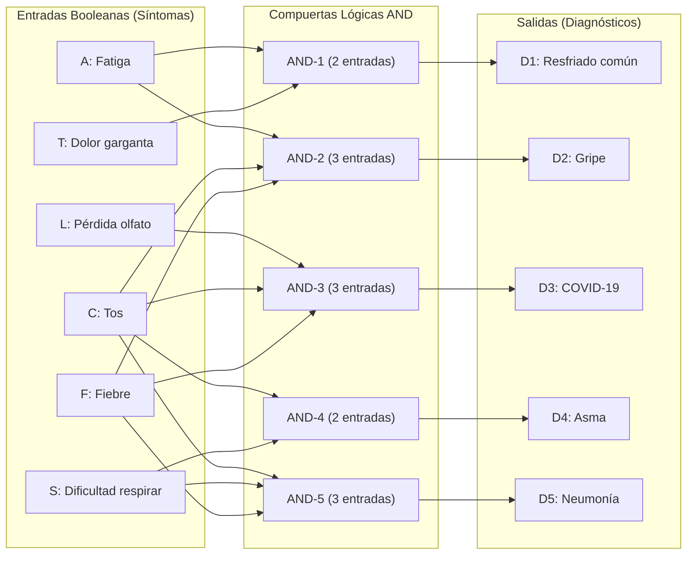

# Proposiciones, Tablas de Verdad y Circuitos Lógicos

## 1. Declaración de Proposiciones Atómicas

### 1.1 Proposiciones de Entrada (Síntomas)

Cada síntoma observado en el paciente se modela como una proposición booleana atómica cuyo valor de verdad pertenece al conjunto $\{V, F\}$ (o $\{1, 0\}$ en álgebra booleana):

| Símbolo | Proposición en Lenguaje Natural | Equivalente en Inglés | Dominio |
| :---: | :--- | :--- | :---: |
| $F$ | El paciente presenta fiebre ($> 38\,^\circ\text{C}$). | Fever | $\{V, F\}$ |
| $C$ | El paciente presenta tos persistente. | Cough | $\{V, F\}$ |
| $S$ | El paciente presenta dificultad para respirar (disnea). | Shortness of breath | $\{V, F\}$ |
| $T$ | El paciente presenta dolor de garganta. | Sore throat | $\{V, F\}$ |
| $A$ | El paciente presenta fatiga o cansancio generalizado. | Fatigue | $\{V, F\}$ |
| $L$ | El paciente presenta pérdida de olfato (anosmia/hiposmia). | Loss of smell | $\{V, F\}$ |

### 1.2 Proposiciones de Salida (Hipótesis Diagnósticas)

| Símbolo | Hipótesis Diagnóstica | Código en Sistema | Severidad Clínica |
| :---: | :--- | :---: | :---: |
| $D_1$ | Posible Resfriado común | `COLD` | Baja (`LOW`) |
| $D_2$ | Posible Gripe | `FLU` | Moderada (`MEDIUM`) |
| $D_3$ | Posible COVID-19 | `COVID19` | Alta (`HIGH`) |
| $D_4$ | Posible Asma | `ASTHMA` | Alta (`HIGH`) |
| $D_5$ | Posible Neumonía | `PNEUMONIA` | Crítica (`CRITICAL`) |

---

## 2. Reglas de Producción en Lógica Proposicional

Las cinco reglas base establecidas en el enunciado se formalizan como implicaciones materiales cuyo antecedente es una conjunción ($\land$) de síntomas:

| Código | Enunciado | Fórmula Proposicional | Especificidad |
| :---: | :--- | :---: | :---: |
| $R_1$ | Si dolor de garganta y fatiga, entonces posible resfriado común. | $(T \land A) \rightarrow D_1$ | 2 premisas |
| $R_2$ | Si fiebre, tos y fatiga, entonces posible gripe. | $(F \land C \land A) \rightarrow D_2$ | 3 premisas |
| $R_3$ | Si fiebre, tos y pérdida de olfato, entonces posible COVID-19. | $(F \land C \land L) \rightarrow D_3$ | 3 premisas |
| $R_4$ | Si dificultad para respirar y tos, entonces posible asma. | $(S \land C) \rightarrow D_4$ | 2 premisas |
| $R_5$ | Si fiebre, dificultad para respirar y tos, entonces posible neumonía. | $(F \land S \land C) \rightarrow D_5$ | 3 premisas |

> [!IMPORTANT]
> **Análisis de solapamiento lógico:** El conjunto de premisas de $R_4$ es un subconjunto propio del antecedente de $R_5$: $\{S, C\} \subset \{F, S, C\}$. En consecuencia, siempre que se active $R_5$ (Neumonía), también se satisface $R_4$ (Asma). El motor de inferencia resuelve este conflicto mediante una estrategia de prioridad por especificidad (3 premisas frente a 2) y severidad clínica (`CRITICAL` frente a `HIGH`), manteniendo $D_4$ como diagnóstico diferencial secundario.

---

## 3. Tablas de Verdad Completas

En un sistema experto basado en reglas de producción, una regla se dispara únicamente cuando su antecedente conjuntivo evalúa a Verdadero ($V / 1$). A continuación se presentan las tablas de verdad completas para las cinco reglas del sistema.

### 3.1 Regla $R_1$: $(T \land A) \rightarrow D_1$ (Resfriado común, $2^2 = 4$ combinaciones)

| # | $T$ (Garganta) | $A$ (Fatiga) | $T \land A$ | Dispara $D_1$ (Resfriado) |
| :-: | :-: | :-: | :-: | :-: |
| 1 | V (1) | V (1) | **V (1)** | **SÍ** |
| 2 | V (1) | F (0) | F (0) | NO |
| 3 | F (0) | V (1) | F (0) | NO |
| 4 | F (0) | F (0) | F (0) | NO |

### 3.2 Regla $R_2$: $(F \land C \land A) \rightarrow D_2$ (Gripe, $2^3 = 8$ combinaciones)

| # | $F$ (Fiebre) | $C$ (Tos) | $A$ (Fatiga) | $F \land C \land A$ | Dispara $D_2$ (Gripe) |
| :-: | :-: | :-: | :-: | :-: | :-: |
| 1 | V (1) | V (1) | V (1) | **V (1)** | **SÍ** |
| 2 | V (1) | V (1) | F (0) | F (0) | NO |
| 3 | V (1) | F (0) | V (1) | F (0) | NO |
| 4 | V (1) | F (0) | F (0) | F (0) | NO |
| 5 | F (0) | V (1) | V (1) | F (0) | NO |
| 6 | F (0) | V (1) | F (0) | F (0) | NO |
| 7 | F (0) | F (0) | V (1) | F (0) | NO |
| 8 | F (0) | F (0) | F (0) | F (0) | NO |

### 3.3 Regla $R_3$: $(F \land C \land L) \rightarrow D_3$ (COVID-19, $2^3 = 8$ combinaciones)

| # | $F$ (Fiebre) | $C$ (Tos) | $L$ (Olfato) | $F \land C \land L$ | Dispara $D_3$ (COVID-19) |
| :-: | :-: | :-: | :-: | :-: | :-: |
| 1 | V (1) | V (1) | V (1) | **V (1)** | **SÍ** |
| 2 | V (1) | V (1) | F (0) | F (0) | NO |
| 3 | V (1) | F (0) | V (1) | F (0) | NO |
| 4 | V (1) | F (0) | F (0) | F (0) | NO |
| 5 | F (0) | V (1) | V (1) | F (0) | NO |
| 6 | F (0) | V (1) | F (0) | F (0) | NO |
| 7 | F (0) | F (0) | V (1) | F (0) | NO |
| 8 | F (0) | F (0) | F (0) | F (0) | NO |

### 3.4 Regla $R_4$: $(S \land C) \rightarrow D_4$ (Asma, $2^2 = 4$ combinaciones)

| # | $S$ (Disnea) | $C$ (Tos) | $S \land C$ | Dispara $D_4$ (Asma) |
| :-: | :-: | :-: | :-: | :-: |
| 1 | V (1) | V (1) | **V (1)** | **SÍ** |
| 2 | V (1) | F (0) | F (0) | NO |
| 3 | F (0) | V (1) | F (0) | NO |
| 4 | F (0) | F (0) | F (0) | NO |

### 3.5 Regla $R_5$: $(F \land S \land C) \rightarrow D_5$ (Neumonía, $2^3 = 8$ combinaciones)

| # | $F$ (Fiebre) | $S$ (Disnea) | $C$ (Tos) | $F \land S \land C$ | Dispara $D_5$ (Neumonía) |
| :-: | :-: | :-: | :-: | :-: | :-: |
| 1 | V (1) | V (1) | V (1) | **V (1)** | **SÍ** |
| 2 | V (1) | V (1) | F (0) | F (0) | NO |
| 3 | V (1) | F (0) | V (1) | F (0) | NO |
| 4 | V (1) | F (0) | F (0) | F (0) | NO |
| 5 | F (0) | V (1) | V (1) | F (0) | NO |
| 6 | F (0) | V (1) | F (0) | F (0) | NO |
| 7 | F (0) | F (0) | V (1) | F (0) | NO |
| 8 | F (0) | F (0) | F (0) | F (0) | NO |

---

## 4. Validación mediante Circuitos Lógicos

Cada regla de producción se implementa a nivel de lógica combinacional mediante compuertas **AND** de 2 o 3 entradas conectadas a las líneas de entrada de los 6 sensores/indicadores de síntomas ($F, C, S, T, A, L$).

### Validación Combinacional

* Para replicar este circuito en herramientas de simulación como **Logisim Evolution** o **CircuitVerse**, se colocan 6 pines de entrada de 1 bit (`F, C, S, T, A, L`), cinco compuertas `AND` (dos de 2 entradas y tres de 3 entradas) y 5 LEDs de salida (`D1..D5`).
* En el sistema web implementado, el módulo [formal-logic.ts](../../web/src/domain/logic/formal-logic.ts) calcula dinámicamente la tabla de verdad y el circuito equivalente para cada regla almacenada en PostgreSQL, incluyendo compuertas `NOT` si el usuario agrega premisas negadas desde el panel de gestión.
