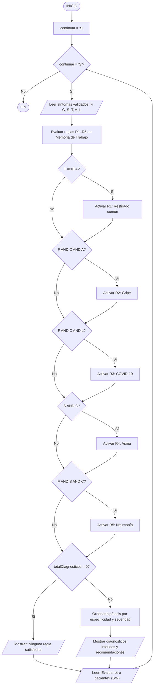
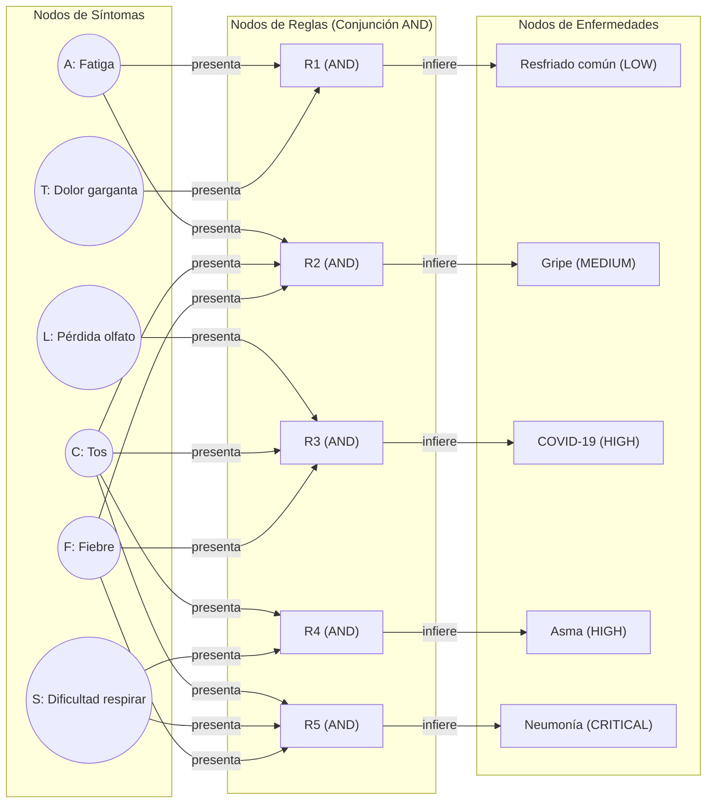

# Pseudocódigo (PSeInt), Diagrama de Flujo y Grafos de Conocimiento

## 1. Pseudocódigo Validado para PSeInt

El archivo fuente ejecutable se encuentra en [sistema_deteccion_respiratoria.psc](./sistema_deteccion_respiratoria.psc). Está redactado en sintaxis estándar de **PSeInt (perfil flexible/estricto)** con validación defensiva de entradas (`S`/`N`), evaluación independiente de las 5 reglas mediante operadores lógicos conjuntivos (`Y`) y presentación ordenada por especificidad y severidad clínica.

### Cobertura del Algoritmo
* **Entrada validada:** Función auxiliar `LeerSintoma(nombreSintoma)` que impide continuar hasta recibir `S` o `N`.
* **Evaluación completa:** Evalúa las 5 reglas ($R_1..R_5$) sin cortocircuitar de forma excluyente, permitiendo detectar diagnósticos concurrentes (como $R_5$ Neumonía junto con $R_4$ Asma).
* **Control de casos sin coincidencia:** Cuando `totalDiagnosticos = 0`, informa que ninguna regla se cumplió completamente y sugiere monitoreo clínico.
* **Ciclo iterativo:** Permite evaluar múltiples pacientes en la misma sesión de ejecución.

---

## 2. Diagrama de Flujo del Sistema

El diagrama utiliza simbología estándar de flujo (terminales Inicio/Fin, paralelogramos de entrada/salida, rombos de decisión y rectángulos de proceso):

---

## 3. Grafo de Conocimiento (Red Semántica)

El grafo de conocimiento modela explícitamente los **nodos de síntomas**, los **nodos de reglas conjuntivas (nodos de inferencia)** y los **nodos de enfermedades**, conectados mediante aristas dirigidas etiquetadas (`presenta` e `infiere`). Esta representación tripartita evita la ambigüedad de un grafo bipartito simple (donde no se distingue si una enfermedad requiere conjunción `AND` o disyunción `OR` de sus síntomas).

> [!NOTE]
> En la aplicación web desplegada, este grafo se genera dinámicamente en formato SVG interactivo desde el módulo [graph-builder.ts](../../web/src/domain/engine/graph-builder.ts) y [KnowledgeGraphView.tsx](../../web/src/components/KnowledgeGraphView.tsx) leyendo en tiempo real las tablas `symptoms`, `rules`, `rule_symptoms` y `diseases` de PostgreSQL.
