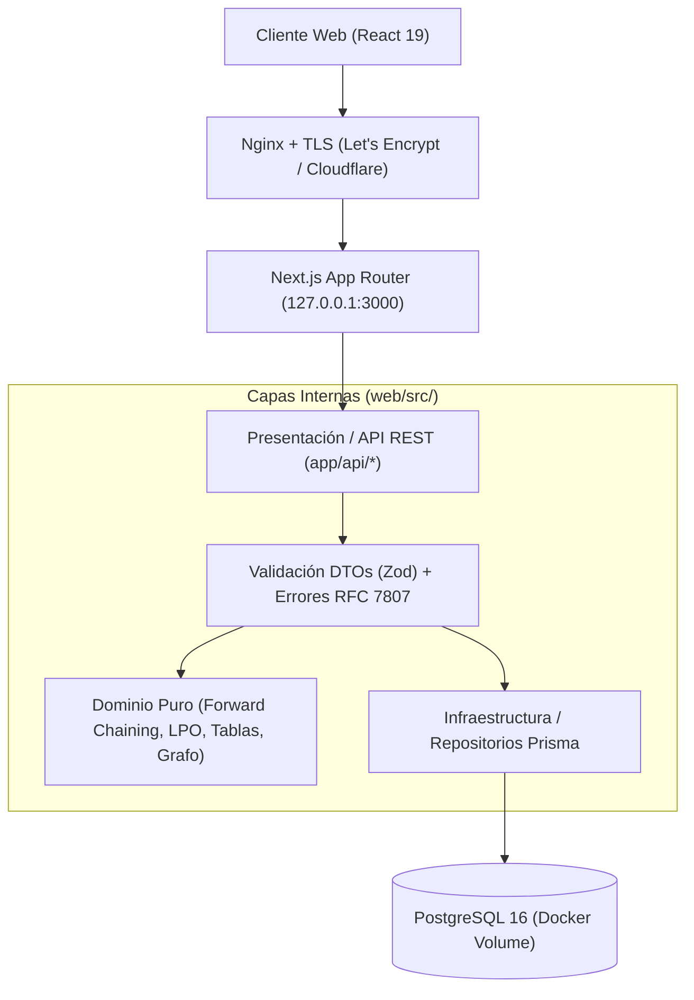

# Arquitectura del Sistema Web y Despliegue en Producción

En cumplimiento con las orientaciones del proyecto (*"Cualquier herramienta adicional, debe ser aplicada y reflejada en el informe final"*), se implementó y desplegó un **Sistema Experto Web Full-Stack** operativo en `https://proyecto-final-integrador-grupo-5.doicela.dev`.

---

## 1. Arquitectura de Capas (Clean Architecture)

La aplicación fue construida en **Next.js 15 (App Router, TypeScript estricto)** con persistencia en **PostgreSQL 16 (Prisma ORM)**, separando estrictamente la lógica simbólica del framework web:

---

## 2. Modelo de Datos Relacional (PostgreSQL)

Definido en [schema.prisma](../../web/prisma/schema.prisma) y versionado mediante migraciones reproducibles:

| Tabla | Propósito | Claves e Índices Principales |
| :--- | :--- | :--- |
| `symptoms` | Catálogo de proposiciones/síntomas ($F, C, S, T, A, L$ y adicionales). | PK `id` (UUID), `UNIQUE(code)`, `INDEX(is_active)` |
| `diseases` | Catálogo de patologías, severidad (`LOW..CRITICAL`) y recomendaciones. | PK `id` (UUID), `UNIQUE(code)`, `INDEX(severity)` |
| `rules` | Reglas de producción con prioridad y vínculo a su enfermedad consecuente. | PK `id` (UUID), `UNIQUE(code)`, FK `disease_id`, `INDEX(is_active)` |
| `rule_symptoms` | Relación N:M entre reglas y síntomas premisa (soporta flag `is_negated`). | PK `id`, `UNIQUE(rule_id, symptom_id)`, FKs con `ON DELETE CASCADE` |
| `evaluations` | Historial persistente de diagnósticos ejecutados y su traza deductiva. | PK `id` (UUID), columnas JSONB (`selected_symptoms`, `matched_diagnoses`, `inference_trace`), `INDEX(created_at DESC)` |

---

## 3. Contratos de API REST

| Método | Ruta | Función | Códigos HTTP |
| :---: | :--- | :--- | :---: |
| `GET` | `/api/health` | Verificación de estado de aplicación y conexión PostgreSQL (`SELECT 1`). | `200`, `503` |
| `GET` | `/api/knowledge-base` | Devuelve síntomas, enfermedades, reglas, formalizaciones LPO/tablas y grafo. | `200`, `500` |
| `POST` | `/api/knowledge-base/reset` | Restaura de forma idempotente las 5 reglas, 6 síntomas y 5 enfermedades base. | `200`, `500` |
| `GET` / `POST` | `/api/evaluations` | Lista evaluaciones recientes o ejecuta inferencia *Forward Chaining* y persiste. | `200`, `201`, `422` |
| `DELETE` | `/api/evaluations/[id]` | Elimina un registro del historial. | `204`, `404` |
| `GET` / `POST` | `/api/rules` | Consulta o crea reglas de producción en transacción atómica. | `200`, `201`, `409`, `422` |
| `PATCH` / `DELETE` | `/api/rules/[id]` | Actualiza premisas/estado o elimina una regla. | `200`, `204`, `404` |
| `GET` / `POST` / `PATCH` / `DELETE` | `/api/symptoms`, `/api/diseases` | Gestión CRUD completa de síntomas y enfermedades. | `200`, `201`, `204`, `404`, `409`, `422` |

---

## 4. Pipeline CI/CD y Despliegue en Debian

* **Construcción en CI:** [deploy.yml](../../.github/workflows/deploy.yml) ejecuta `tsc --noEmit` y `vitest run` antes de compilar la imagen multi-stage ([Dockerfile](../../web/Dockerfile)) y publicarla en GitHub Container Registry (`ghcr.io`).
* **Despliegue sin compilación en servidor:** El VPS Debian descarga la imagen precompilada y levanta el stack con [docker-compose.prod.yml](../../docker-compose.prod.yml). Al iniciar, [docker-entrypoint.sh](../../web/docker-entrypoint.sh) aplica `prisma migrate deploy` y el seed idempotente antes de arrancar `server.js` con usuario no-root (`nextjs`).
* **Exposición HTTPS:** Nginx en Debian termina TLS (certificado Let's Encrypt gestionado por Certbot) detrás de Cloudflare y redirige el tráfico únicamente hacia `127.0.0.1:3000`.
