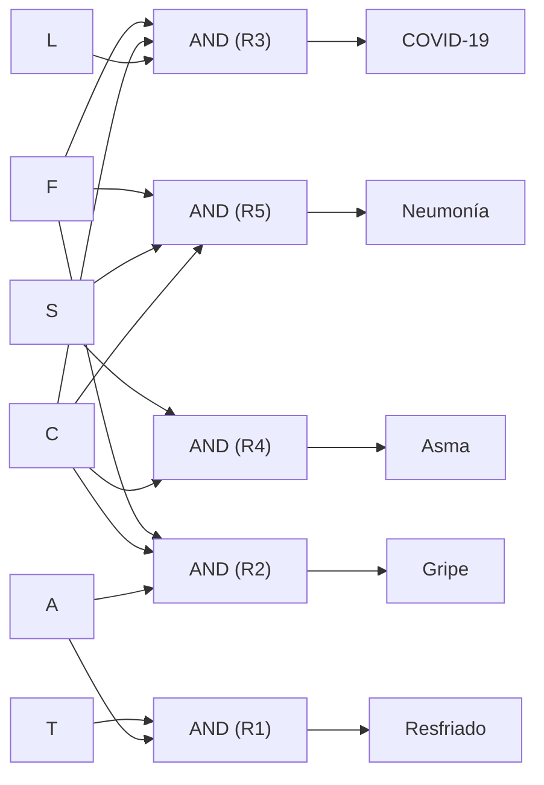
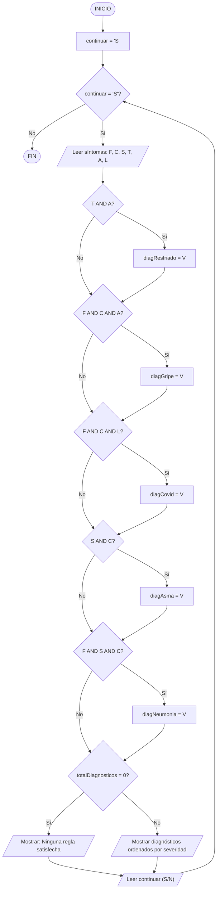
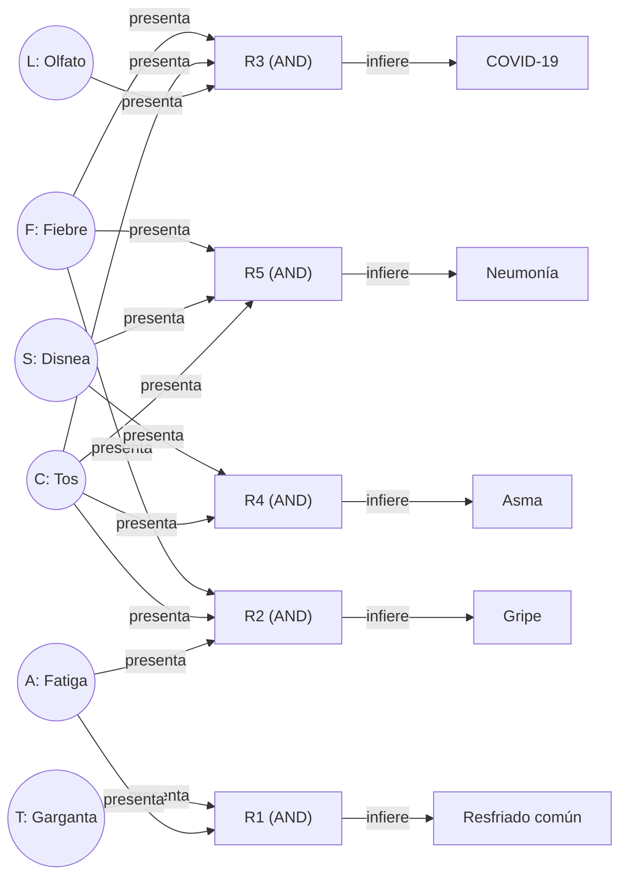

# Proyecto Integrador Final: Implementación de un Sistema de Detección de Enfermedades Respiratorias

---

## 1. Carátula

* **Institución:** Universidad Bolivariana del Ecuador (UBE)
* **Asignatura:** Representación del Conocimiento y Razonamiento
* **Unidad:** Unidad 1 — Actividades de Aprendizaje (Proyecto Integrador Final)
* **Título del Proyecto:** Implementación de un Sistema Experto Basado en Reglas para la Detección de Enfermedades Respiratorias
* **Grupo:** Grupo 5
* **Integrantes:**
  1. Jorge Doicela
  2. *[Completar nombre del integrante 2]*
  3. *[Completar nombre del integrante 3]*
  4. *[Completar nombre del integrante 4]*
  5. *[Completar nombre del integrante 5]*
* **Docente:** *[Completar nombre del docente]*
* **Fecha de Entrega:** Noviembre 2026
* **Herramienta Web Desplegada (Demo en vivo):** `https://proyecto-final-integrador-grupo-5.doicela.dev`
* **Repositorio de Código Fuente:** `https://github.com/JorgeDoicela/grupo5_proyecto_integrador_final`

---

## 2. Introducción

Los sistemas basados en conocimiento (sistemas expertos) constituyen una rama fundamental de la Inteligencia Artificial simbólica orientada a formalizar el criterio de especialistas humanos mediante estructuras lógicas verificables. En el ámbito de la salud, el triaje inicial de afecciones respiratorias presenta un reto recurrente debido a la superposición de síntomas comunes entre patologías de distinta gravedad clínica, como el resfriado común, la gripe, el COVID-19, el asma y la neumonía.

El presente proyecto integra los fundamentos teóricos de la asignatura **Representación del Conocimiento y Razonamiento** —lógica proposicional, tablas de verdad, circuitos combinacionales, Lógica de Primer Orden (LPO), métodos de inferencia deductiva, algoritmos estructurados y grafos de conocimiento— en una solución verificable tanto en papel como en software. Como valor agregado contemplado en las orientaciones generales del proyecto, el modelo lógico se implementó como un **Sistema Experto Web Full-Stack** (Next.js, PostgreSQL y Docker) que ejecuta dinámicamente las reglas, explica paso a paso sus deducciones y renderiza el grafo semántico en tiempo real.

---

## 3. Objetivos

### 3.1 Objetivo General
Implementar un Sistema de Detección de Enfermedades Respiratorias basado en reglas lógicas, aplicando técnicas de representación del conocimiento y razonamiento deductivo desde su formalización matemática hasta su validación algorítmica y despliegue en una plataforma web funcional.

### 3.2 Objetivos Específicos
1. Analizar y complementar el enunciado clínico base, identificando casos de solapamiento entre reglas y criterios de priorización por severidad.
2. Declarar las proposiciones atómicas y formular las reglas de producción en lógica proposicional, validando su comportamiento mediante tablas de verdad completas y circuitos lógicos.
3. Formalizar el dominio en Lógica de Primer Orden (LPO) mediante predicados, constantes y cuantificadores universales, y derivar conclusiones verificables aplicando encadenamiento hacia adelante (*Forward Chaining*) y *Modus Ponens*.
4. Construir y validar el pseudocódigo estructurado en PSeInt junto con su diagrama de flujo estándar y el grafo de conocimiento que representa las relaciones entre síntomas, reglas y patologías.
5. Desplegar una aplicación web interactiva con base de datos relacional que materialice el motor de inferencia, la visualización del grafo y la administración dinámica de la base de conocimiento.

---

## 4. Análisis y Complementación del Enunciado

### 4.1 Dominio Base del Enunciado
* **Enfermedades consideradas (5):** Resfriado común (`COLD`), Gripe (`FLU`), COVID-19 (`COVID19`), Asma (`ASTHMA`) y Neumonía (`PNEUMONIA`).
* **Síntomas considerados (6):** Fiebre ($F$), Tos ($C$), Dificultad para respirar ($S$), Dolor de garganta ($T$), Fatiga ($A$) y Pérdida de olfato ($L$).

### 4.2 Complementaciones Técnicas Identificadas por el Grupo
Al analizar formalmente las 5 reglas propuestas, el equipo detectó cuatro aspectos necesarios para que el sistema sea consistente en un escenario real:

1. **Resolución de conflictos por solapamiento lógico ($R_4 \subset R_5$):** La regla de Asma ($S \land C$) es un subconjunto estricto de la regla de Neumonía ($F \land S \land C$). Si un paciente presenta fiebre, disnea y tos, ambas reglas se satisfacen simultáneamente. Se incorporó una estrategia formal de resolución de conflictos basada en: (a) **especificidad** (mayor número de premisas satisfechas), (b) **severidad clínica** (`CRITICAL > HIGH > MEDIUM > LOW`) y (c) **prioridad de regla**.
2. **Diagnósticos múltiples y coincidencias parciales:** En lugar de usar estructuras `Si-Sino` excluyentes que ocultarían patologías concurrentes, el motor evalúa todas las reglas activas y, cuando ninguna se cumple al 100%, reporta coincidencias parciales (porcentaje de cobertura y síntomas faltantes) como orientación diagnóstica sin emitir falsos positivos.
3. **Regla complementaria de triaje crítico:** Se añadió una regla de segundo nivel en LPO que activa una alerta de atención médica urgente cuando la patología inferida posee severidad crítica (ej. Neumonía).
4. **Implementación de herramienta adicional (Sistema Web Full-Stack):** Se desarrolló y publicó un sistema experto en `https://proyecto-final-integrador-grupo-5.doicela.dev` con arquitectura Clean (Next.js 15 + TypeScript + PostgreSQL 16 + Prisma + Docker + CI/CD en GitHub Actions) que permite evaluar pacientes, inspeccionar la traza de *Modus Ponens*, consultar tablas de verdad dinámicas, explorar el grafo de conocimiento y administrar (CRUD) las reglas en vivo.

---

## 5. Desarrollo de las Proposiciones

### 5.1 Proposiciones de Entrada (Síntomas)

| Símbolo | Proposición | Equivalente en Inglés |
| :---: | :--- | :--- |
| $F$ | El paciente presenta fiebre ($> 38\,^\circ\text{C}$). | Fever |
| $C$ | El paciente presenta tos. | Cough |
| $S$ | El paciente presenta dificultad para respirar. | Shortness of breath |
| $T$ | El paciente presenta dolor de garganta. | Sore throat |
| $A$ | El paciente presenta fatiga. | Fatigue |
| $L$ | El paciente presenta pérdida de olfato. | Loss of smell |

### 5.2 Proposiciones de Salida (Diagnósticos) y Reglas Proposicionales

| Regla | Fórmula Proposicional | Interpretación | Severidad |
| :---: | :---: | :--- | :---: |
| $R_1$ | $(T \land A) \rightarrow D_1$ | Posible Resfriado común (`COLD`) | Baja |
| $R_2$ | $(F \land C \land A) \rightarrow D_2$ | Posible Gripe (`FLU`) | Moderada |
| $R_3$ | $(F \land C \land L) \rightarrow D_3$ | Posible COVID-19 (`COVID19`) | Alta |
| $R_4$ | $(S \land C) \rightarrow D_4$ | Posible Asma (`ASTHMA`) | Alta |
| $R_5$ | $(F \land S \land C) \rightarrow D_5$ | Posible Neumonía (`PNEUMONIA`) | Crítica |

---

## 6. Tablas de Verdad y Validación mediante Circuitos

### 6.1 Tablas de Verdad de las 5 Reglas

**Regla $R_1$: $(T \land A) \rightarrow D_1$ (Resfriado común)**

| $T$ | $A$ | $T \land A$ | Infiere $D_1$ |
| :-: | :-: | :-: | :-: |
| V | V | **V** | **SÍ** |
| V | F | F | NO |
| F | V | F | NO |
| F | F | F | NO |

**Regla $R_2$: $(F \land C \land A) \rightarrow D_2$ (Gripe)**

| $F$ | $C$ | $A$ | $F \land C \land A$ | Infiere $D_2$ |
| :-: | :-: | :-: | :-: | :-: |
| V | V | V | **V** | **SÍ** |
| V | V | F | F | NO |
| V | F | V | F | NO |
| V | F | F | F | NO |
| F | V | V | F | NO |
| F | V | F | F | NO |
| F | F | V | F | NO |
| F | F | F | F | NO |

**Regla $R_3$: $(F \land C \land L) \rightarrow D_3$ (COVID-19)**

| $F$ | $C$ | $L$ | $F \land C \land L$ | Infiere $D_3$ |
| :-: | :-: | :-: | :-: | :-: |
| V | V | V | **V** | **SÍ** |
| V | V | F | F | NO |
| V | F | V | F | NO |
| V | F | F | F | NO |
| F | V | V | F | NO |
| F | V | F | F | NO |
| F | F | V | F | NO |
| F | F | F | F | NO |

**Regla $R_4$: $(S \land C) \rightarrow D_4$ (Asma)**

| $S$ | $C$ | $S \land C$ | Infiere $D_4$ |
| :-: | :-: | :-: | :-: |
| V | V | **V** | **SÍ** |
| V | F | F | NO |
| F | V | F | NO |
| F | F | F | NO |

**Regla $R_5$: $(F \land S \land C) \rightarrow D_5$ (Neumonía)**

| $F$ | $S$ | $C$ | $F \land S \land C$ | Infiere $D_5$ |
| :-: | :-: | :-: | :-: | :-: |
| V | V | V | **V** | **SÍ** |
| V | V | F | F | NO |
| V | F | V | F | NO |
| V | F | F | F | NO |
| F | V | V | F | NO |
| F | V | F | F | NO |
| F | F | V | F | NO |
| F | F | F | F | NO |

### 6.2 Validación mediante Circuitos Lógicos

Cada antecedente conjuntivo se representa físicamente con compuertas lógicas `AND` de 2 o 3 entradas:



---

## 7. Formalización en Lógica de Primer Orden (LPO)

* **Dominio ($\mathcal{U}$):** Pacientes, síntomas y enfermedades respiratorias.
* **Predicados:** $\text{Paciente}(x)$, $\text{PresentaSintoma}(x, s)$, $\text{PosibleDiagnostico}(x, d)$, $\text{SeveridadCritica}(d)$, $\text{RequiereAtencionUrgente}(x)$.

1. **Enunciado 1 (Resfriado común):**
   $$\forall x \big( (\text{Paciente}(x) \land \text{PresentaSintoma}(x, \text{DolorGarganta}) \land \text{PresentaSintoma}(x, \text{Fatiga})) \rightarrow \text{PosibleDiagnostico}(x, \text{ResfriadoComun}) \big)$$
   *Explicación:* Universaliza la implicación para todo individuo $x$ que sea paciente y presente ambos síntomas.

2. **Enunciado 2 (Gripe):**
   $$\forall x \big( (\text{Paciente}(x) \land \text{PresentaSintoma}(x, \text{Fiebre}) \land \text{PresentaSintoma}(x, \text{Tos}) \land \text{PresentaSintoma}(x, \text{Fatiga})) \rightarrow \text{PosibleDiagnostico}(x, \text{Gripe}) \big)$$
   *Explicación:* Modela la tríada gripal de fiebre, tos y fatiga como condición suficiente para inferir posible gripe.

3. **Enunciado 3 (COVID-19):**
   $$\forall x \big( (\text{Paciente}(x) \land \text{PresentaSintoma}(x, \text{Fiebre}) \land \text{PresentaSintoma}(x, \text{Tos}) \land \text{PresentaSintoma}(x, \text{PerdidaOlfato})) \rightarrow \text{PosibleDiagnostico}(x, \text{COVID19}) \big)$$
   *Explicación:* Diferencia la sospecha de COVID-19 mediante el predicado de anosmia/pérdida de olfato.

4. **Enunciado 4 (Asma):**
   $$\forall x \big( (\text{Paciente}(x) \land \text{PresentaSintoma}(x, \text{Disnea}) \land \text{PresentaSintoma}(x, \text{Tos})) \rightarrow \text{PosibleDiagnostico}(x, \text{Asma}) \big)$$
   *Explicación:* Captura el patrón bronco-obstructivo de disnea acompañada de tos.

5. **Enunciado 5 (Neumonía):**
   $$\forall x \big( (\text{Paciente}(x) \land \text{PresentaSintoma}(x, \text{Fiebre}) \land \text{PresentaSintoma}(x, \text{Disnea}) \land \text{PresentaSintoma}(x, \text{Tos})) \rightarrow \text{PosibleDiagnostico}(x, \text{Neumonia}) \big)$$
   *Explicación:* Extiende el cuadro de disnea y tos con fiebre para detectar posible compromiso infeccioso pulmonar.

6. **Enunciado 6 (Alerta de Triaje Crítico — Regla Complementaria):**
   $$\forall x \, \forall d \big( (\text{PosibleDiagnostico}(x, d) \land \text{SeveridadCritica}(d)) \rightarrow \text{RequiereAtencionUrgente}(x) \big)$$
   *Explicación:* Permite encadenamiento deductivo de segundo nivel para escalar a atención urgente cuando el diagnóstico derivado es crítico.

---

## 8. Razonamiento de Conclusiones

### 8.1 Método Seleccionado: Encadenamiento hacia Adelante (*Forward Chaining*)
Se seleccionó *Forward Chaining* con **Instanciación Universal (IU)** y **Modus Ponens (MP)** porque el problema es dirigido por datos (*data-driven*): se parte de los síntomas conocidos del paciente para derivar todas las conclusiones válidas, aplicando resolución de conflictos por especificidad y severidad cuando se disparan varias reglas.

### 8.2 Derivación de Conclusiones

* **Conclusión 1 — Paciente $p_1$ con $\{F, C, L\}$:**
  1. Hechos: $\text{Paciente}(p_1)$, $\text{PresentaSintoma}(p_1, \text{Fiebre})$, $\text{PresentaSintoma}(p_1, \text{Tos})$, $\text{PresentaSintoma}(p_1, \text{PerdidaOlfato})$.
  2. Instanciación Universal en $R_3$ ($x / p_1$) + Introducción de Conjunción + **Modus Ponens**.
  3. **Conclusión derivada:** $\text{PosibleDiagnostico}(p_1, \text{COVID19})$.

* **Conclusión 2 — Paciente $p_2$ con $\{F, S, C\}$ (Conflicto $R_5$ vs. $R_4$ y encadenamiento):**
  1. Hechos: $\text{Paciente}(p_2)$, $\text{PresentaSintoma}(p_2, \text{Fiebre})$, $\text{PresentaSintoma}(p_2, \text{Disnea})$, $\text{PresentaSintoma}(p_2, \text{Tos})$, $\text{SeveridadCritica}(\text{Neumonia})$.
  2. IU + MP en $R_4$ deriva $\text{PosibleDiagnostico}(p_2, \text{Asma})$ (2 premisas, severidad `HIGH`).
  3. IU + MP en $R_5$ deriva $\text{PosibleDiagnostico}(p_2, \text{Neumonia})$ (3 premisas, severidad `CRITICAL`).
  4. Resolución de conflictos prioriza **Neumonía** (principal) y mantiene **Asma** (diferencial).
  5. IU + MP en Enunciado 6 deriva $\text{RequiereAtencionUrgente}(p_2)$.

* **Conclusión 3 — Paciente $p_3$ con $\{F, C, A, T\}$ (Concurrencia $R_2$ y $R_1$):**
  1. IU + MP en $R_1$ deriva $\text{PosibleDiagnostico}(p_3, \text{ResfriadoComun})$ (2 premisas, `LOW`).
  2. IU + MP en $R_2$ deriva $\text{PosibleDiagnostico}(p_3, \text{Gripe})$ (3 premisas, `MEDIUM`).
  3. Resolución de conflictos prioriza **Gripe** como hipótesis principal y **Resfriado común** como diferencial.

---

## 9. Desarrollo del Pseudocódigo (Validado en PSeInt)

El archivo ejecutable completo se encuentra en [sistema_deteccion_respiratoria.psc](../02-algoritmo-y-grafos/sistema_deteccion_respiratoria.psc):

```pseint
Algoritmo SistemaDeteccionRespiratoria
    Definir F, C, S, T, A, L Como Logico
    Definir diagResfriado, diagGripe, diagCovid, diagAsma, diagNeumonia Como Logico
    Definir continuar Como Caracter
    Definir totalDiagnosticos Como Entero

    continuar <- "S"
    Mientras Mayusculas(continuar) = "S" Hacer
        F <- LeerSintoma("Fiebre (F)")
        C <- LeerSintoma("Tos (C)")
        S <- LeerSintoma("Dificultad para respirar (S)")
        T <- LeerSintoma("Dolor de garganta (T)")
        A <- LeerSintoma("Fatiga (A)")
        L <- LeerSintoma("Perdida de olfato (L)")

        diagResfriado <- T Y A
        diagGripe     <- F Y C Y A
        diagCovid     <- F Y C Y L
        diagAsma      <- S Y C
        diagNeumonia  <- F Y S Y C

        totalDiagnosticos <- 0
        Si diagResfriado Entonces totalDiagnosticos <- totalDiagnosticos + 1 FinSi
        Si diagGripe Entonces totalDiagnosticos <- totalDiagnosticos + 1 FinSi
        Si diagCovid Entonces totalDiagnosticos <- totalDiagnosticos + 1 FinSi
        Si diagAsma Entonces totalDiagnosticos <- totalDiagnosticos + 1 FinSi
        Si diagNeumonia Entonces totalDiagnosticos <- totalDiagnosticos + 1 FinSi

        Si totalDiagnosticos = 0 Entonces
            Escribir "No se cumplio completamente ninguna regla diagnostica."
        SiNo
            Si diagNeumonia Entonces Escribir "[R5 | CRITICA] Posible NEUMONIA (F ^ S ^ C)" FinSi
            Si diagCovid Entonces Escribir "[R3 | ALTA] Posible COVID-19 (F ^ C ^ L)" FinSi
            Si diagGripe Entonces Escribir "[R2 | MODERADA] Posible GRIPE (F ^ C ^ A)" FinSi
            Si diagAsma Entonces Escribir "[R4 | ALTA] Posible ASMA (S ^ C)" FinSi
            Si diagResfriado Entonces Escribir "[R1 | BAJA] Posible RESFRIADO COMUN (T ^ A)" FinSi
        FinSi

        Escribir "Desea evaluar otro paciente? (S/N): "
        Leer continuar
    FinMientras
FinAlgoritmo
```

---

## 10. Gráfico del Diagrama de Flujo



---

## 11. Grafos de Conocimiento

El grafo tripartito representa explícitamente síntomas (premisas), reglas conjuntivas (`AND`) y enfermedades (consecuentes):



---

## 12. Conclusiones y Bibliografía

### 12.1 Conclusiones
1. La formalización en lógica proposicional y Lógica de Primer Orden permitió eliminar ambigüedades del lenguaje natural y evidenciar el solapamiento estructural entre la regla de Asma ($R_4$) y la regla de Neumonía ($R_5$).
2. La aplicación de encadenamiento hacia adelante (*Forward Chaining*) con resolución de conflictos por especificidad y severidad clínica garantiza respuestas deterministas, trazables y alineadas con criterios de prioridad médica.
3. La separación entre base de conocimiento (PostgreSQL) y motor de inferencia (dominio puro en TypeScript) demostrada en el sistema web desplegado permite modificar o ampliar reglas sin reprogramar el algoritmo central, actualizando automáticamente las tablas de verdad y el grafo de conocimiento.

### 12.2 Bibliografía (Normas APA 7)
* Russell, S. J., & Norvig, P. (2021). *Artificial Intelligence: A Modern Approach* (4th ed.). Pearson.
* Giarratano, J. C., & Riley, G. D. (2005). *Expert Systems: Principles and Programming* (4th ed.). Course Technology.
* Brachman, R. J., & Levesque, H. J. (2004). *Knowledge Representation and Reasoning*. Morgan Kaufmann.
* Rosen, K. H. (2019). *Discrete Mathematics and Its Applications* (8th ed.). McGraw-Hill Education.
* Organización Mundial de la Salud (OMS). (2023). *Manejo clínico de la infección respiratoria aguda grave y criterios de triaje*. Ginebra: OMS.
